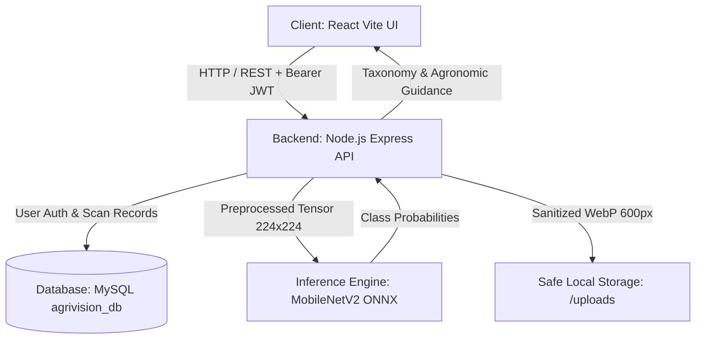

# AgriVision AI — Tomato Leaf Disease Detection (Full-Stack System)

**AgriVision AI** is a production-grade agricultural pathology web application designed to assist growers, students, and agronomists in identifying tomato leaf diseases (*Solanum lycopersicum*), understanding botanical symptoms, and reviewing verified agronomic management solutions.

The application connects a modern React frontend to a live Node.js + Express backend powered by a local MobileNetV2 ONNX neural network and persistent MySQL database storage.

---

## 🌿 System Architecture



### Technology Stack
- **Frontend**: React 18, Vite, Vanilla CSS design tokens, custom SVG icons.
- **Backend API**: Node.js (ES modules), Express, JWT authentication, `sharp` for image sanitization and resizing.
- **Inference Runtime**: `onnxruntime-node` executing pre-trained MobileNetV2 ONNX model (`224x224 RGB`, Softmax probabilities).
- **Database**: MySQL 8.0 with `mysql2/promise` connection pooling, indexed foreign keys, and strict SQL user isolation.
- **Agronomic Knowledge Base**: Verified diagnostic taxonomy and IPM management protocols adhering to ICAR-IIVR and USDA guidelines.

---

## 🚀 Key Implemented Features (Version 1 Scope)

### 1. Authentication & Security
- **Endpoints**: `POST /api/auth/register`, `POST /api/auth/login`, `GET /api/auth/me`.
- Strong password hashing with `bcrypt` (10 rounds).
- Stateless JWT authentication with Bearer tokens stored in client `localStorage`.
- Automatic session restoration on browser refresh and clean logout handling.
- Rejection of missing, malformed, tampered, or expired tokens (HTTP 401).

### 2. Neural Network Leaf Pathology Scan
- **Endpoint**: `POST /api/scans/detect` (protected, `multipart/form-data`).
- Safe upload handling: 10MB memory buffer limit, `sharp` magic-byte verification (JPEG, PNG, WEBP). Non-image files disguised as `.jpg` are rejected.
- Preprocessing: 224×224 RGB image normalized to `[-1.0, 1.0]` via `(pixel - 127.5) / 127.5`.
- Supported Classes: 10 verified tomato categories (Early Blight, Late Blight, Bacterial Spot, Septoria, Leaf Mold, Spider Mites, Target Spot, Mosaic Virus, Yellow Leaf Curl, Healthy).
- Non-fabricated predictions: Calibrated Softmax confidence percentages.
- **Unsupported Crop & Out-of-Domain Safeguard**: Non-tomato foliage or unsupported species are detected via the 38-class classifier; the system honestly flags them as `Unsupported Crop` / `Inconclusive` rather than fabricating a tomato diagnosis.
- **Low-Confidence Warning Card**: Triggered automatically when confidence falls below 60%.
- Safe Storage: Leaves are re-encoded to sanitized 600px WebP files under `/uploads/` using system-generated UUIDs (`path.basename` sanitation) to prevent executable file uploads, path traversal, and disk exhaustion.

### 3. Agronomic Guidance & Solutions
- Detailed symptom breakdowns (concentric target lesions, chlorotic halos, defoliation patterns).
- Multi-tier mitigation protocols:
  - **Cultural & Preventative Measures** (trellising, crop rotation, drip irrigation).
  - **Organic & Biological Options** (copper octanoate, *Bacillus subtilis*, beneficial predators).
  - **Chemical Intervention Protocol** (advisories against indiscriminate spraying and reminder of pre-harvest intervals).
- Mandatory legal and extension disclaimer statement on all diagnostic reports.

### 4. Scan History & Record Management
- **Endpoints**: `GET /api/scans/history`, `GET /api/scans/:id`, `DELETE /api/scans/:id`.
- Strict SQL-level data isolation: Users can only view, query, and delete their own scans (`WHERE user_id = ?`).
- Interactive filtering (All, Infected, Healthy) and live text search by disease name or scan ID.
- Record deletion modal with instantaneous cascade removal from both MySQL and disk storage.

---

## 🔒 Security & Privacy Notes

1. **Upload Storage & Path Traversal**:
   - Files uploaded to `/uploads/` use generated IDs (`SCN-YYYY-XXXXXX_leaf.webp`). User-supplied filenames are never used as filesystem paths.
   - Deletion uses `path.basename()` to neutralize directory traversal attempts (`../../`).
2. **Private-Image Exposure (Privacy Risk Observation)**:
   - `/uploads` is served statically via `express.static()`. While filenames are random and obscure, image URLs do not enforce session tokens once issued. For sensitive clinical or enterprise deployments, access to uploaded images should be routed through an authenticated streaming controller.
3. **JWT Storage Security**:
   - Tokens are stored in browser `localStorage`. While standard for single-page applications without custom backend proxy domains, `localStorage` is accessible to scripts in the same origin and is vulnerable if an XSS exploit is present. Future hardening should transition authentication tokens to `HttpOnly`, `SameSite=Strict` secure cookies.

---

## 🛠️ Getting Started Locally

### Prerequisites
- Node.js (v18 or higher)
- MySQL Server (v8.0) running locally on port 3306

### 1. Database Setup
Ensure MySQL is running, then run migrations:
```powershell
# Navigate to backend
cd backend

# Execute database migration (creates agrivision_db, users, and scans tables)
node src/db/migrate.js
```

### 2. Backend API Server
```powershell
cd backend
npm install
npm start
# Server listens at http://localhost:5000
# Health check available at http://localhost:5000/api/health
```

### 3. Frontend Development Server
```powershell
cd frontend
npm install
npm run dev
# Frontend runs at http://localhost:5174
```

---

## 🧪 Acceptance Testing & Verification

### Backend Automated Test Suite
Execute all 26 automated integration tests:
```powershell
cd backend
npm test
```
**Test Coverage Includes:**
- **Authentication (10 tests)**: Registration format validation, duplicate email prevention, password hashing with bcrypt, login credentials verification, session access `/api/auth/me`, rejection of unauthenticated, invalid signature, and expired tokens.
- **SQL Ownership & Isolation (6 tests)**: Single-user scan persistence, strict multi-user SQL query isolation, cross-user deletion denial, cross-user detail retrieval denial, and authorized deletion.
- **Upload & Model Inference (7 tests)**: Unauthenticated request rejection, missing field rejection, magic-byte spoofing rejection (non-image renamed to .jpg), oversized file rejection (>10 MB), genuine tomato leaf inference, healthy leaf inference, and unsupported crop / non-tomato safeguard.

### Frontend Validation
```powershell
cd frontend
npm run lint    # oxlint: 0 warnings, 0 errors
npm run build   # vite build: production bundle compiles cleanly
```
