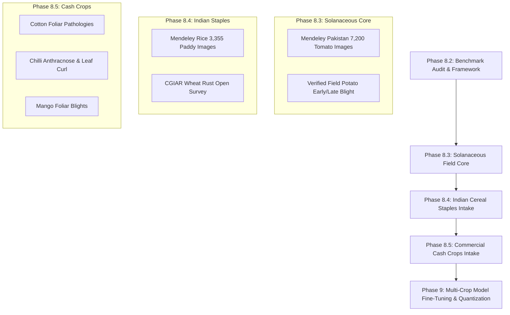

# AgriVision AI — Multi-Plant Dataset Gap Analysis & Indian Crop Roadmap

**Document ID:** `AGRIVISION-DATASET-GAPS-V1`  
**Date:** October 28, 2026  
**Audience:** AgriVision AI Engineering, Agronomy Team, and Project Leadership  
**Status:** Approved Reference  

---

## 1. Executive Summary

AgriVision AI is architected to be an intelligent agricultural diagnosis platform for multiple plant species and crops, with specific emphasis on Indian agricultural realities.

The baseline system was initialized with a 38-class MobileNetV2 ONNX model (`backend/models/mobilenet_v2.onnx`). While this model provided a rapid starting point, Phase 7 and Phase 8 audits demonstrate that it has **severe structural gaps**:
1. **Zero Coverage for Vital Indian Staples & Cash Crops:** The current model has **0 classes** for Rice (Paddy), Wheat, Cotton, Sugarcane, Mango, Chilli, Mustard, and Pulses (Chickpea/Arhar).
2. **Laboratory Shortcut Bias:** All 38 classes were trained on isolated leaves photographed on uniform laboratory cardboard (PlantVillage), resulting in 0% diagnostic accuracy on outdoor field images.
3. **Acute Class Imbalance:** Certain laboratory classes (e.g., Tomato Yellow Leaf Curl Virus with 3,209 samples) dwarf other critical diseases (Tomato Mosaic Virus with 373 samples), biasing predictions towards majority classes under field noise.
4. **Candidate Dataset Disconnect:** While datasets like PlantDoc and various Mendeley repositories exist, they differ wildly in quality, labeling granularity (binary vs pathological), domain authenticity, and legal clearance.

This document presents a structured gap analysis across three core groups:
- **Group A:** Current Baseline Model Classes (38 PlantVillage Classes)
- **Group B:** Candidate Open Datasets Audited in Phase 8
- **Group C:** Critical Indian Agricultural Staples and Cash Crops

---

## 2. Group A: Baseline Model Class Analysis (PlantVillage 38 Classes)

The baseline model classifies 38 classes across 14 plant species. All images originate from the 2015–2016 PlantVillage laboratory collection.

### 2.1 Distribution of Classes and Sample Counts

| Crop Species | Model Classes | Specific Classes in Taxonomy | Approx. Training Samples | Domain / Background |
| :--- | :---: | :--- | :---: | :--- |
| **Tomato** (*Solanum lycopersicum*) | **10** | Bacterial Spot, Early Blight, Late Blight, Leaf Mold, Septoria Leaf Spot, Two-spotted Spider Mite, Target Spot, Yellow Leaf Curl Virus, Mosaic Virus, Healthy | ~18,160 | Laboratory Cardboard |
| **Apple** (*Malus domestica*) | **4** | Apple Scab, Black Rot, Cedar Apple Rust, Healthy | ~3,171 | Laboratory Cardboard |
| **Corn / Maize** (*Zea mays*) | **4** | Cercospora Leaf Spot / Gray Leaf Spot, Common Rust, Northern Leaf Blight, Healthy | ~3,852 | Laboratory Cardboard |
| **Grape** (*Vitis vinifera*) | **4** | Black Rot, Esca (Black Measles), Leaf Blight (Isariopsis), Healthy | ~4,062 | Laboratory Cardboard |
| **Potato** (*Solanum tuberosum*) | **3** | Early Blight, Late Blight, Healthy | ~2,152 | Laboratory Cardboard |
| **Bell Pepper** (*Capsicum annuum*) | **2** | Bacterial Spot, Healthy | ~2,475 | Laboratory Cardboard |
| **Cherry** (*Prunus avium*) | **2** | Powdery Mildew, Healthy | ~1,906 | Laboratory Cardboard |
| **Peach** (*Prunus persica*) | **2** | Bacterial Spot, Healthy | ~2,657 | Laboratory Cardboard |
| **Strawberry** (*Fragaria ananassa*) | **2** | Leaf Scorch, Healthy | ~1,565 | Laboratory Cardboard |
| **Blueberry** (*Vaccinium corymbosum*) | **1** | Healthy only | ~1,502 | Laboratory Cardboard |
| **Orange / Citrus** (*Citrus sinensis*) | **1** | Huanglongbing (Citrus Greening) only | ~5,507 | Laboratory Cardboard |
| **Raspberry** (*Rubus idaeus*) | **1** | Healthy only | ~371 | Laboratory Cardboard |
| **Soybean** (*Glycine max*) | **1** | Healthy only | ~5,090 | Laboratory Cardboard |
| **Squash** (*Cucurbita pepo*) | **1** | Powdery Mildew only | ~1,835 | Laboratory Cardboard |
| **TOTAL** | **38** | **14 Crop Species** | **~54,305** | **100% Laboratory Cardboard** |

### 2.2 Critical Limitations of Group A:
1. **Severe Class Imbalance Within Species:**
   - In Tomato: Yellow Leaf Curl Virus has **3,209 images**, while Mosaic Virus has only **373 images** (8.6x imbalance).
   - In Raspberry: Only 371 images total.
   - In Citrus / Orange: Only Huanglongbing (greening) is present; there is NO healthy orange leaf class, meaning any orange leaf is artificially forced into a severe quarantine disease diagnosis.
2. **Absence of Negative / Out-of-Domain Classes:**
   - There is NO background, weed, hand, soil, or non-foliar class. Any input must be assigned to one of the 38 classes.
3. **Absence of Real Field Artifacts:**
   - Zero exposure to sunlight reflections, soil particles, drip irrigation pipes, multiple overlapping leaves, or insect vectors.

---

## 3. Group B: Candidate Open Datasets Audited in Phase 8

| Source Name | Crops Covered | Pathology Classes | Image Count | Domain Type | License | Suitability / Verdict |
| :--- | :--- | :--- | :--- | :--- | :--- | :--- |
| **Tomato Leaf Disease in Pakistan** (Mendeley `3mbnb82mxd/2`) | Tomato only | 6 classes (Early Blight, Late Blight, Leaf Mold, Septoria, TYLCV, Healthy) | **7,200** | **Authentic Field** (Smartphone photos in natural fields) | CC BY 4.0 | **APPROVED** for Benchmark & Training (Pending manual intake via browser CDN) |
| **PlantDoc Dataset** (GitHub / Kayal et al.) | 13 plant species (Tomato, Potato, Corn, Apple, Grape, Pepper, etc.) | 27 classes (17 disease, 10 healthy) | 2,598 | Authentic Field (Internet Scraped) | CC-BY-4.0 (Repo level) | **RESTRICTED / RESEARCH ONLY**: Contains web-scraped images with unverified third-party copyrights. Excluded from locked eval benchmark. |
| **Tomato Leaf Dataset 2025** (PMC12008584 / Mendeley `bpfd9cns5g/2`) | Tomato only | 9 classes (Early Blight, Late Blight, Leaf Mold, Septoria, Spider Mite, Target Spot, TYLCV, Mosaic, Healthy) | 2,429 | Authentic Field (High quality Nikon D3500) | CC BY 4.0 (Mendeley) / Non-commercial Research restriction (Paper) | **CONDITIONAL**: Permitted for internal validation, but commercial use restricted by ethical statement. |
| **Real-World Tomato Leaf Image Dataset** (Mendeley `rnbsw72zb5/1`) | Tomato only | **2 classes only: Healthy ("H") vs Diseased ("D")** | ~1,200 | Authentic Field | CC BY 4.0 | **REJECTED**: Binary label only; lacks pathological specificity needed for actionable farmer guidance. |
| **Rice Leaf Disease Dataset** (Mendeley `fwcj7stb8r/1`) | Rice / Paddy only | 3 classes (Bacterial Leaf Blight, Brown Spot, Rice Blast) | **3,355** | Authentic Field (South Asian paddy agro-ecosystem) | CC BY 4.0 | **APPROVED** for Indian Roadmap Phase 8.4 intake. |
| **PlantVillage** (Penn State / EPFL) | 14 crops | 38 classes | 54,305 | Laboratory Cardboard | CC0 / Public Domain | **REFERENCE ONLY**: Unsuitable for field inference; creates false laboratory shortcuts. |

---

## 4. Group C: Critical Indian Agricultural Staples & Cash Crops

The primary mission of AgriVision AI is to serve Indian agriculture. In India, smallholder farmers depend on cereal staples, fiber cash crops, oilseeds, and pulses that are completely omitted from the baseline model.

### 4.1 Gap Matrix for Top Indian Crops

| Crop Name (English / Hindi / Botanical) | Economic / Agronomic Significance in India | Prevalent Diseases Requiring AI Diagnosis | Presence in Baseline Model | Presence in Audited Datasets | Priority Level |
| :--- | :--- | :--- | :---: | :---: | :---: |
| **Rice / Paddy** चावल / धान (*Oryza sativa*) | Primary staple food for >60% of India; ~45 million hectares under cultivation. | 1. Bacterial Leaf Blight (*Xanthomonas oryzae*) 2. Rice Blast (*Magnaporthe oryzae*) 3. Brown Spot (*Bipolaris oryzae*) 4. Sheath Blight (*Rhizoctonia solani*) | **0 classes (0%)** | Covered in Mendeley `fwcj7stb8r/1` (3,355 images) | **P0 (Immediate)** |
| **Wheat** गेहूँ (*Triticum aestivum*) | Second primary staple; ~31 million hectares (Punjab, Haryana, UP, MP). | 1. Yellow/Stripe Rust (*Puccinia striiformis*) 2. Brown/Leaf Rust (*Puccinia triticina*) 3. Karnal Bunt (*Tilletia indica*) 4. Powdery Mildew (*Blumeria graminis*) | **0 classes (0%)** | Open data available via CGIAR / Wheat Rust Toolbox | **P1 (High)** |
| **Cotton** कपास (*Gossypium hirsutum*) | Premier fiber cash crop; >6 million smallholders (Gujarat, Maharashtra, Telangana). | 1. Bacterial Blight / Angular Leaf Spot (*Xanthomonas citri*) 2. Cotton Leaf Curl Virus (CLCuV) 3. Alternaria Leaf Spot 4. Grey Mildew | **0 classes (0%)** | Partial coverage in CGIAR Cotton Survey & Mendeley | **P1 (High)** |
| **Sugarcane** गन्ना (*Saccharum officinarum*) | Major commercial crop (UP, Maharashtra, Karnataka); supports 50M+ livelihoods. | 1. Red Rot (*Colletotrichum falcatum*) 2. Smut (*Sporisorium scitamineum*) 3. Wilt / Pokkah Boeng 4. Grassy Shoot Disease | **0 classes (0%)** | Available in ICAR Sugarcane Breeding Institute datasets | **P2 (Medium)** |
| **Chilli / Hot Pepper** मिर्च (*Capsicum frutescens/annuum*) | Essential spice & cash crop; India is the world's largest producer & exporter. | 1. Chilli Leaf Curl Virus (ChiLCV) 2. Anthracnose / Fruit Rot / Dieback (*Colletotrichum capsici*) 3. Powdery Mildew 4. Cercospora Leaf Spot | **0 classes** *(Only sweet Bell Pepper in model)* | Partial coverage in Indian ICAR & PlantDoc | **P1 (High)** |
| **Mango** आम (*Mangifera indica*) | National fruit; India produces ~45% of global supply. High economic value. | 1. Anthracnose (*Colletotrichum gloeosporioides*) 2. Powdery Mildew (*Oidium mangiferae*) 3. Dieback / Bacterial Canker | **0 classes (0%)** | Available in Indian Horticulture Open Repository | **P2 (Medium)** |
| **Potato** आलू (*Solanum tuberosum*) | Major vegetable cash crop (UP, West Bengal, Bihar). High vulnerability to blight. | 1. Early Blight (*Alternaria solani*) 2. Late Blight (*Phytophthora infestans*) 3. Black Scurf | **3 classes** *(Lab only; 0 field)* | In PlantDoc & Mendeley | **P0 (Immediate)** |
| **Mustard / Rapeseed** सरसों (*Brassica juncea*) | Major edible oilseed crop of Northern & Western India. | 1. White Rust (*Albugo candida*) 2. Alternaria Blight 3. Downy Mildew | **0 classes (0%)** | ICAR-DRMR research data | **P2 (Medium)** |
| **Pulses (Chickpea / Arhar)** चना / अरहर (*Cicer arietinum / Cajanus cajan*) | Crucial protein source for Indian population; nitrogen-fixing staple. | 1. Fusarium Wilt (*Fusarium oxysporum*) 2. Ascochyta Blight 3. Dry Root Rot | **0 classes (0%)** | ICRISAT Open Data repository | **P2 (Medium)** |

---

## 5. Taxonomic Incompatibility & Pathological Overlap Risks

A frequent shortcut in computer vision projects is to casually merge "similar-looking" disease classes across plant species (e.g., treating all "blights" or "leaf spots" as one generic class). **In agricultural decision support, this is medically dangerous and must be strictly forbidden.**

### 5.1 Why Early Blight and Late Blight Cannot Be Merged
- **Early Blight** is caused by the fungus *Alternaria solani*.
  - Manifests as concentric target rings with yellow halos.
  - Thrives in warm, alternating wet/dry weather.
  - Managed using protectant fungicides (Mancozeb, Chlorothalonil) or strobilurins.
- **Late Blight** is caused by the oomycete water-mold *Phytophthora infestans*.
  - Manifests as rapid water-soaked lesions that turn dark brown/purplish, with white mildew on undersides during high humidity.
  - Can destroy an entire field within 72 hours.
  - Managed using specific systemic oomycete-targeted compounds (Metalaxyl, Cymoxanil, Dimethomorph).
- **Risk:** If an AI labels Late Blight as Early Blight, the farmer applies ineffective fungicides, leading to 100% crop loss.

### 5.2 Why Leaf Curl Viruses Differ Across Crops
- **Tomato Yellow Leaf Curl Virus (TYLCV)** vs **Chilli Leaf Curl Virus (ChiLCV)** vs **Cotton Leaf Curl Virus (CLCuV)**:
  - While all are begomoviruses transmitted by whiteflies (*Bemisia tabaci*), they involve distinct viral complexes and host-specific resistance traits.
  - AI models must clearly identify the host crop before asserting the viral strain.

---

## 6. Recommended Multi-Plant Acquisition Roadmap for Indian Agriculture

To transition AgriVision AI from a laboratory prototype to a production-grade Indian agricultural tool, data acquisition must follow a phased, legally sound sequence:

### Milestone Specifications:

### Phase 8.3 — Solanaceous Field Core (Tomato + Potato)
- **Target:** 10,000+ authentic in-field images.
- **Actions:**
  1. Complete manual browser download of Mendeley Pakistan dataset (`3mbnb82mxd/2`).
  2. Ingest into `dataset/raw/tomato_pakistan_2026/`.
  3. Preprocess and filter blurry/unlabeled images.
  4. Perform SHA-256 deduplication against existing test files.
  5. Acquire verified field Potato Early and Late Blight images under CC-BY-4.0.

### Phase 8.4 — Indian Cereal Staples (Rice + Wheat)
- **Target:** 5,000+ field images.
- **Actions:**
  1. Ingest Mendeley Rice Leaf Dataset (`fwcj7stb8r/1`) into `dataset/raw/rice_mendeley_2020/`.
  2. Implement monocot foliar preprocessing (aspect-ratio preservation for narrow rice leaves).
  3. Source open-access Wheat Yellow Rust and Brown Rust imagery from ICAR / CGIAR.

### Phase 8.5 — Commercial Cash Crops (Chilli + Cotton + Mango)
- **Target:** 6,000+ field images.
- **Actions:**
  1. Source Indian Chilli Leaf Curl and Anthracnose images.
  2. Ingest Cotton Bacterial Blight imagery.
  3. Formulate a 2-stage hierarchical classification architecture (Crop Identification Stage $\rightarrow$ Pathology Diagnostic Stage) to prevent cross-crop false alarms.
