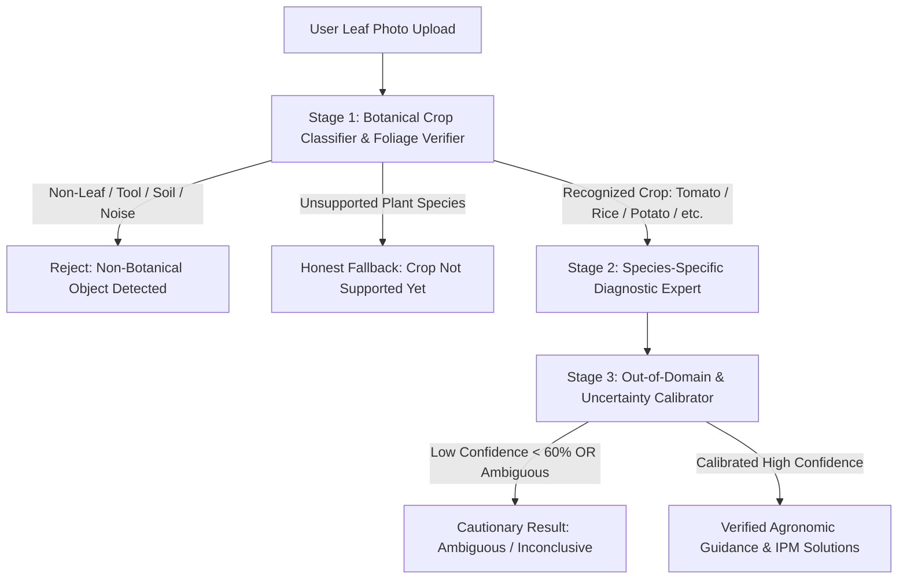
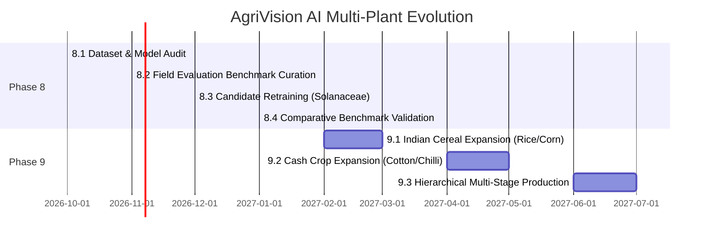

# AgriVision AI — Multi-Plant Model Architecture & Roadmap Plan

**Document Version**: 1.0.0  
**Status**: Architecture Blueprint & Strategy  
**Focus**: Multi-Plant Crop Disease Diagnosis for Indian & Subcontinental Agriculture  
**Runtime Target**: Local ONNX Runtime on CPU (<35ms), Node.js Express, MySQL, React  

---

## 1. Vision & Strategic Rationale

AgriVision AI is built to provide accessible, real-time diagnostic decision-support for smallholder farmers, extension officers, and agricultural students across India and South Asia.

- **Initial Prototype Scope**: Early development phases focused on tomato foliage to validate end-to-end inference, image sanitation, database isolation, and UX workflows.
- **Strategic Evolution**: Indian agriculture encompasses diverse agro-climatic zones with complex multi-cropping systems. A production agricultural diagnostic tool cannot be restricted to a single vegetable.
- **Core Engineering Mandate**: Expand the platform to accurately recognize and diagnose diseases across major **staple cereals, cash crops, pulses, vegetables, and horticultural fruits**, while maintaining absolute diagnostic honesty: **when a plant species or disease is outside model capability, return a clear, uncalibrated out-of-scope notification rather than a fabricated diagnosis.**

---

## 2. Comprehensive Taxonomy & Coverage Breakdown

### Group A: Plants & Classes Supported by the Current Baseline Model (38 PlantVillage Classes)

The baseline model ([backend/models/mobilenet_v2.onnx](file:///d:/almost%20done/krishi/backend/models/mobilenet_v2.onnx)) outputs 38 classes across 14 plant species, mapped in [labels.json](file:///d:/almost%20done/krishi/backend/models/labels.json):

| Crop Species | Supported Classes in Current Model | Diagnostic Quality / Clinical Utility |
| :--- | :--- | :--- |
| **Tomato** (*Solanum lycopersicum*) | 10 classes (9 diseases + Healthy): Bacterial Spot, Early Blight, Late Blight, Leaf Mold, Septoria Leaf Spot, Spider Mites, Target Spot, TYLCV, Mosaic Virus, Healthy. | ⚠️ **Severe field misclassification** due to lab background bias and TYLCV prior imbalance. |
| **Potato** (*Solanum tuberosum*) | 3 classes: Early Blight, Late Blight, Healthy Potato. | ⚠️ Lab-only; lacks Black Scurf, Common Scab, and Virus Y. |
| **Bell Pepper / Capsicum** (*Capsicum annuum*) | 2 classes: Bacterial Spot, Healthy Bell Pepper. | ⚠️ Limited coverage; lacks Anthracnose, Powdery Mildew, and Leaf Curl. |
| **Corn / Maize** (*Zea mays*) | 4 classes: Cercospora / Gray Leaf Spot, Common Rust, Northern Leaf Blight, Healthy Corn. | ⚠️ Lab-only; Northern leaf blight features require field validation. |
| **Grape** (*Vitis vinifera*) | 4 classes: Black Rot, Esca (Black Measles), Isariopsis Leaf Spot, Healthy Grape. | ⚠️ Lab-only; lacks Downy Mildew and Powdery Mildew. |
| **Apple** (*Malus domestica*) | 4 classes: Apple Scab, Black Rot, Cedar Apple Rust, Healthy Apple. | ⚠️ Lab-only; relevant primarily to Himachal Pradesh / J&K orchard zones. |
| **Orange / Citrus** (*Citrus sinensis*) | 1 class: Citrus Greening (*Huanglongbing*). | ❌ Incomplete; zero healthy citrus class, zero Citrus Canker class. |
| **Peach** (*Prunus persica*) | 2 classes: Bacterial Spot, Healthy Peach. | ⚠️ Minor temperate crop in India. |
| **Blueberry** (*Vaccinium*) | 1 class: Healthy Blueberry Plant only (0 disease classes). | ❌ Irrelevant to broad Indian farming; zero diagnostic disease value. |
| **Raspberry** (*Rubus*) | 1 class: Healthy Raspberry Plant only (0 disease classes). | ❌ Irrelevant to broad Indian farming; zero diagnostic disease value. |
| **Soybean** (*Glycine max*) | 1 class: Healthy Soybean Plant only (0 disease classes). | ❌ Major Indian crop (MP/Maharashtra), but model has **zero disease classes**. |
| **Squash** (*Cucurbita*) | 1 class: Powdery Mildew only (0 healthy class). | ⚠️ Single isolated fungal class. |
| **Strawberry** (*Fragaria*) | 2 classes: Leaf Scorch, Healthy Strawberry. | ⚠️ High-value niche horticultural crop. |
| **Cherry** (*Prunus avium*) | 2 classes: Powdery Mildew, Healthy Cherry. | ⚠️ Minor temperate crop. |

**Baseline Summary Assessment**:
- 14 species represented, but **only Tomato, Potato, Corn, Grape, and Apple have multi-disease coverage**.
- 4 species (Blueberry, Raspberry, Soybean, Citrus) have only 1 class, rendering them diagnostically useless for differential pathology.
- **Critical Flaw**: All 38 classes were trained on detached leaves placed on uniform monochrome sheets, causing near-total failure (0.00% empirical accuracy) on outdoor field foliage.

---

### Group B: Plants & Classes Available in Candidate Datasets

These classes possess verified, in-field photographic datasets suitable for held-out benchmarking and transfer learning:

| Crop Species | Candidate In-Field Datasets | Classes Available with Field Ground-Truth |
| :--- | :--- | :--- |
| **Tomato** | PlantDoc (2020), Mendeley Bangladesh (2025), Mendeley Pakistan (2026) | Early Blight, Late Blight, Bacterial Spot, Septoria Leaf Spot, Leaf Mold, Target Spot, Leaf Curl / Yellow Virus, Healthy. |
| **Potato** | PlantDoc (2020) | Potato Early Blight, Potato Late Blight, Healthy Potato. |
| **Bell Pepper / Capsicum** | PlantDoc (2020) | Bell Pepper Leaf Spot (*Xanthomonas*), Healthy Bell Pepper. |
| **Corn / Maize** | PlantDoc (2020) | Corn Gray Leaf Spot, Corn Leaf Blight, Corn Rust, Healthy Corn. |
| **Grape** | PlantDoc (2020) | Grape Black Rot, Healthy Grape Leaf. |
| **Apple** | PlantDoc (2020) | Apple Scab Leaf, Apple Rust Leaf, Healthy Apple Leaf. |
| **Rice / Paddy** (*Oryza sativa*) | Rahman et al. (2020), Mendeley Data / UCI | Bacterial Leaf Blight, Rice Blast, Brown Spot, Leaf Smut, Healthy Rice. |
| **Cotton** (*Gossypium*) | Mendeley / Zenodo Cotton Pathology Datasets | Cotton Leaf Curl Virus (CLCuV), Bacterial Blight, Grey Mildew, Healthy Cotton. |

---

### Group C: Critical Indian Agricultural Crops Still Requiring Data & Validation

These crops are economically vital to Indian agriculture but are **completely absent from the current 38-class model** and require targeted field dataset acquisition:

| Priority Crop | Botanical Name | National Significance in India | Major Pathologies Requiring Data Acquisition |
| :--- | :--- | :--- | :--- |
| **Rice / Paddy** | *Oryza sativa* | #1 Food Staple; 44M hectares across West Bengal, UP, Punjab, AP, TN. | Bacterial Leaf Blight (*Xanthomonas*), Rice Blast (*Magnaporthe*), Brown Spot (*Bipolaris*), Sheath Blight. |
| **Wheat** | *Triticum aestivum* | #2 Food Staple; Punjab, Haryana, UP, MP. | Stripe / Yellow Rust (*Puccinia striiformis*), Leaf / Brown Rust (*Puccinia triticina*), Loose Smut. |
| **Cotton** | *Gossypium hirsutum* | India is the world's #1 cotton producer; Gujarat, Maharashtra, Telangana. | Cotton Leaf Curl Virus (CLCuV), Bacterial Blight (*Xanthomonas malvacearum*), Alternaria Leaf Spot. |
| **Sugarcane** | *Saccharum officinarum* | Core agro-industry in UP, Maharashtra, Karnataka, Tamil Nadu. | Red Rot (*Colletotrichum falcatum*), Smut (*Sporisorium scitamineum*), Grassy Shoot Disease. |
| **Chilli / Hot Pepper** | *Capsicum annuum* | Major cash spice crop; Andhra Pradesh, Telangana, Karnataka. | Chilli Leaf Curl Virus (ChiLCV), Anthracnose / Fruit Rot (*Colletotrichum*), Powdery Mildew. |
| **Mango** | *Mangifera indica* | National fruit; UP, AP, Karnataka, Bihar, Gujarat. | Anthracnose (*Colletotrichum gloeosporioides*), Powdery Mildew, Bacterial Canker. |
| **Pulses / Chickpea** | *Cicer arietinum* | India is the world's largest producer and consumer of pulses; MP, Rajasthan, Maharashtra. | Fusarium Wilt (*Fusarium oxysporum f. sp. ciceris*), Ascochyta Blight, Dry Root Rot. |
| **Mustard / Rapeseed** | *Brassica juncea* | Key edible oilseed crop; Rajasthan, Haryana, UP, MP. | White Rust (*Albugo candida*), Alternaria Blight, Downy Mildew. |
| **Banana** | *Musa acuminata* | Largest fruit production by volume in India; Tamil Nadu, Maharashtra, Gujarat. | Panama Wilt (*Fusarium oxysporum*), Black Sigatoka (*Pseudocercospora fijiensis*), Banana Bunchy Top Virus (BBTV). |
| **Groundnut / Peanut** | *Arachis hypogaea* | Major oilseed; Gujarat, AP, Tamil Nadu, Karnataka. | Tikka Leaf Spot (Early & Late *Cercospora*), Rust (*Puccinia arachidis*). |

---

## 3. Multi-Plant Model Architecture Roadmap

### The Fallacy of Monolithic Flat Classification
Attempting to classify 60+ crop-disease combinations across 15 species with a single flat Softmax layer creates severe cross-species interference:
- Feature representations for early blight on tomato leaves interfere with fungal leaf spots on mango or rice.
- When an unseen weed or novel plant is presented, flat Softmax forces an argmax selection, generating a confident but completely fictitious diagnosis.

### Recommended 3-Stage Hierarchical Diagnostic Engine

#### Stage 1: Crop Species Identification & Foliage Verification
- **Backbone**: Lightweight MobileNetV3-Small or EfficientNet-B0 (~2.5M parameters, <10MB).
- **Function**:
  1. Distinguishes leaf tissue from non-botanical artifacts (human hands, soil, agricultural tools, arbitrary scenes).
  2. Identifies the plant genus/species (Tomato, Potato, Pepper, Rice, Corn, Cotton, Mango, etc.).
- **Fail-Safe Gate**: If the image is not a recognized crop, inference halts immediately with `Unsupported Botanical Specimen` or `Non-Foliar Subject`.

#### Stage 2: Species-Specific Diagnostic Expert
- Once the species is confirmed (e.g., *Solanum lycopersicum*), the tensor is routed to the dedicated crop expert head (or multi-head branch).
- **Benefit**: Tomato diseases compete only against verified tomato pathologies; Rice diseases compete only against rice pathologies. Eliminates cross-family misclassifications (e.g., corn rust predicted on a tomato leaf).

#### Stage 3: Out-of-Domain (OOD) Rejection & Probability Calibration
- Replaces raw Softmax with **Temperature Scaling** ($T \approx 1.4 - 1.8$) and **Energy-Based OOD Scoring**:
  $$E(x; f) = -T \cdot \log \sum_{i=1}^{K} \exp\left(\frac{f_i(x)}{T}\right)$$
- If the free energy $E(x)$ exceeds a validated threshold $\tau$, the sample is classified as **Out-of-Distribution**, preventing overconfident hallucinations on unrepresented diseases.

---

## 4. Diagnostic Integrity & Fallback Policy

The AgriVision AI application must enforce the following strict agronomic policies:

1. **Unrecognized Plant or Disease Display**:
   Where the model lacks high calibrated confidence ($\ge 60\%$) or where the input belongs to Group C (unsupported crop), the user interface must display:
   > **"Plant species or pathology not confidently recognized."**  
   > *Explanation: The visual symptoms do not match calibrated diagnostic markers for supported crops. Do not apply chemical pesticides without certified physical agronomist or extension office inspection.*
2. **Provisional Confidence Thresholds**:
   - `Confidence >= 75%`: High-confidence automated report with agronomic management protocols.
   - `60% <= Confidence < 75%`: Moderate confidence; flagged with yellow field verification advisory.
   - `Confidence < 60%`: Inconclusive; flagged with amber uncertainty card; primary guidance is physical inspection.
3. **Runner-Up Differential Reporting**:
   Always transmit top-3 predictions and confidence margins to the client so that agronomists can observe differential diagnostic possibilities.

---

## 5. Technical Architecture & Non-Breaking Evolution

The planned multi-plant expansion preserves 100% of the existing technical infrastructure:

- **Frontend**: React 18, Vite, Vanilla CSS design tokens. No paid charting or imaging libraries.
- **Backend**: Node.js (ES modules), Express REST API.
- **Image Pipeline**: `multer` memory buffering + `sharp` magic-byte inspection and WebP resizing.
- **Database**: MySQL 8.0 relational schema (`agrivision_db`). The existing `scans` table already supports flexible `disease_key`, `disease_name`, `scientific_name`, and `confidence` columns. A future migration will add a `crop_species` column with foreign key indexing.
- **Inference Runtime**: Local CPU execution via `onnxruntime-node`. Models remain self-hosted, offline-capable, and private with zero paid third-party APIs.

---

## 6. Staged Implementation Roadmap

- **Phase 8.1 (Current)**: Multi-plant legal audit and acquisition plan completed. Baseline model preserved.
- **Phase 8.2**: Download PlantDoc and Tomato Pakistan field datasets into `dataset/raw/`. Assemble held-out multi-plant evaluation set in `dataset/eval/`.
- **Phase 8.3**: Fine-tune candidate MobileNetV3/V2 on in-field data with class-balanced weighting and background augmentation. Export candidate ONNX model.
- **Phase 8.4**: Run `npm run evaluate:dataset <candidate.onnx>`. Verify it decisively outperforms the baseline 0.00% field accuracy before replacing production model.
- **Phase 9.1+**: Ingest Rice and Cotton datasets; activate Stage-1 species classifier and hierarchical routing.
